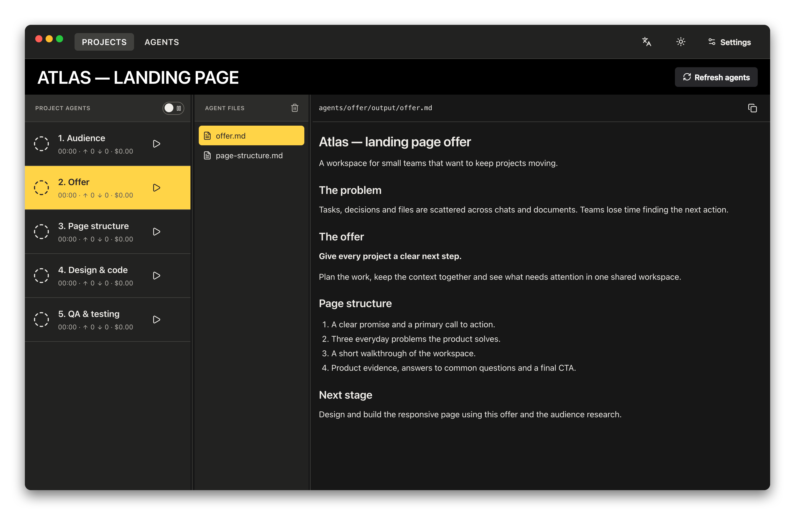
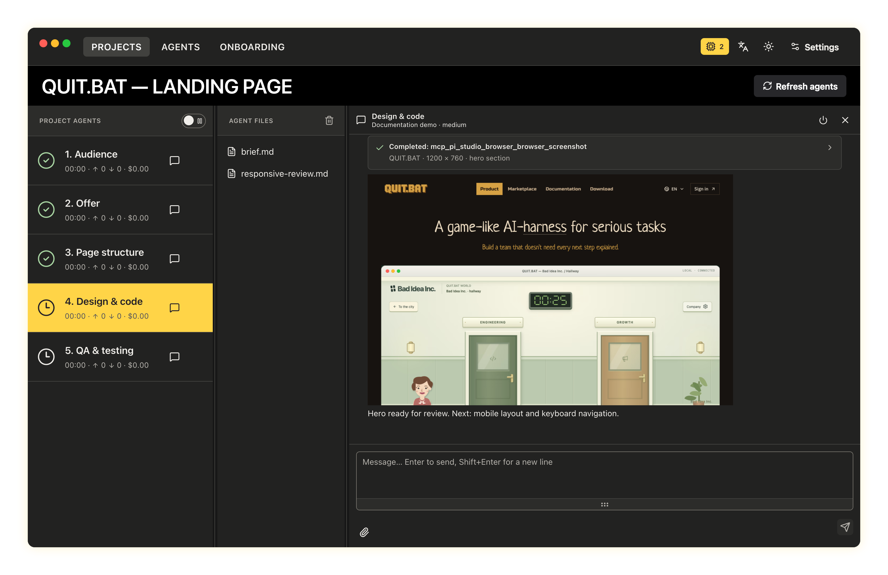
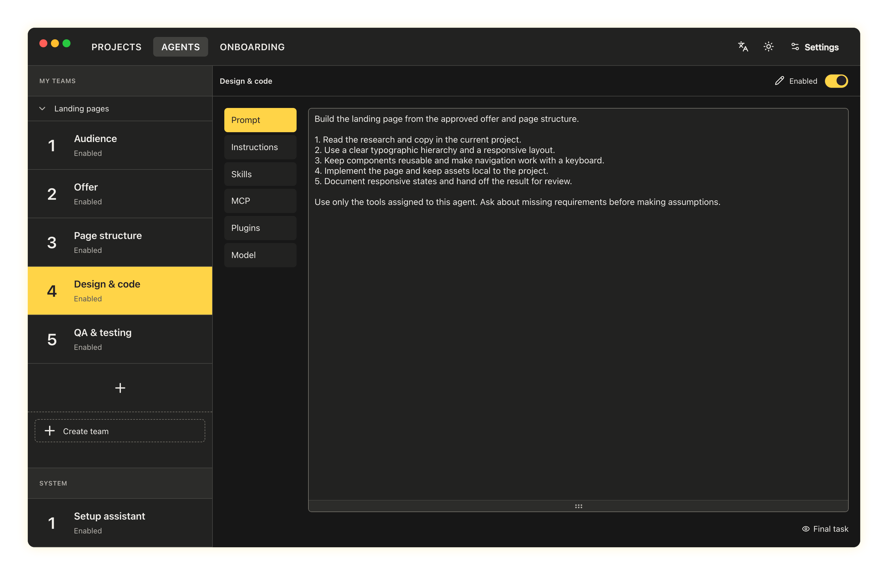
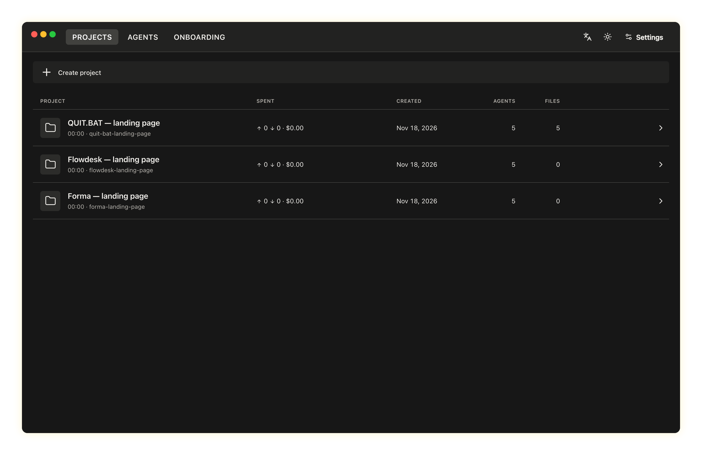

<p align="center"><strong>English</strong> · <a href="README.ru.md">Русский</a></p>

<div align="center">


### An AI agent pipeline for repeatable product development

One agent researches, another creates, a third reviews.<br>Set up the workflow once — reuse it across new projects.

<a href="LICENSE"></a>  

**[Download for macOS ↓](https://github.com/vtlk/pi-studio/releases/download/v0.2.0-alpha.113/Pi-Studio-0.2.0-alpha.113-mac-arm64.zip)** &nbsp; · &nbsp; **[Windows preview ↓](https://github.com/vtlk/pi-studio/releases/download/v0.2.0-alpha.114/Pi-Studio-0.2.0-alpha.114-win-x64.zip)**

**[How it works](#one-team-many-projects)** &nbsp; · &nbsp; **[Models](#your-models-your-tools)** &nbsp; · &nbsp; **[Get started](#quick-start)**

</div>

## One team, many projects

**Pi Studio connects AI agents into a pipeline:** each agent handles a stage and passes its results to the next. Build a team for software development, content or video, then reuse it for each new project.

Built on [Pi](https://github.com/earendil-works/pi). Each agent has its own model, instructions, tools, conversation and results. Project files stay on your computer.



<sub>Current interface in dark mode: an agent chat and the open process list. Projects and conversations use documentation demo data.</sub>

## What can you put on a production line?

Products follow your instructions and rules, using your external connections and tools, a browser and desktop applications through Computer Use.

One team can repeat the entire production process for new products, clients or releases. Here are some example pipelines:

| Area | Example pipeline |
|:---|:---|
| **Landing pages** | Audience pain points → offer creation → landing page type → design and development → responsive layout checks |
| **CRM systems** | Business process mapping → integration analysis → technical specification → development → code review and testing → deployment |
| **Video** | Concept and script → storyboard and asset preparation → animation, voiceover and editing → review and final video → publishing |
| **Content** | Topic and audience research → content plan and structure → material generation → editing → automated posting |
| **Advertising** | Product analysis → offer creation → creative production and variations → platform adaptation → automated posting |

You choose the roles, tools and number of stages. Make a pipeline longer by splitting complex stages between several agents.

## How a team works

| 1. Configure | 2. Run | 3. Repeat |
|:---|:---|:---|
| Add agents, explain each one's task and connect the tools they need. | Create a project and choose “Launch and continue.” Agents work through the stages in order. | Use the same team for your next project. Each project keeps its own files and conversations. |

You can run stages manually, return to any agent and request changes in its conversation. A question or error pauses automatic continuation.

### Agents can ask each other for help

Through the **Pi Studio Team** MCP server, an agent can delegate a task to a teammate, wait for the work to finish and read the result.

> For example, a writer asks a researcher to verify facts, then uses the findings in the text.

This tool is explicitly assigned and works with teammates in the current project.

## Your models, your tools

Choose a separate connection and model for each agent. One agent might use Codex while another uses Claude Code.

| Connections | Available options |
|:---|:---|
| **ChatGPT / Codex, Claude Code, GitHub Copilot** | Connect your account through a supported sign-in method |
| **OpenAI, Anthropic, Google, xAI, DeepSeek, Mistral** | Direct connections to model providers |
| **OpenRouter, Groq, Cerebras, Together, Fireworks and more** | Models through aggregators and inference services |
| **Amazon Bedrock, Azure, Google Vertex AI** | Cloud connections |
| **Local models and compatible APIs** | Your own server with an explicit address and model list |

**[All connections and sign-in methods →](docs/CONNECTIONS.en.md)**

### Give each agent the capabilities it needs

<table>
<tr>
<td width="50%" valign="top">

**MCP — connect to services**

Connect external MCP servers and assign their tools to the agents that need them.

</td>
<td width="50%" valign="top">

**Skills — your ways of working**

Add instructions and skills so an agent follows your rules when doing its work.

</td>
</tr>
<tr>
<td width="50%" valign="top">

**Browser Use — work with websites**

An agent can see a page, click buttons, enter text and work with files in a separate browser.

</td>
<td width="50%" valign="top">

**Computer Use — work with applications**

Window screenshots, clicks, keyboard input and scrolling. Requires OS permissions; full validation is still in progress.

</td>
</tr>
</table>

Browser Use and Computer Use require a model that understands images. Browser components are installed separately. [Requirements and current limitations →](docs/CONNECTIONS.en.md#browser-and-computer-use)

## Setup assistant

Studio includes a **separate built-in agent** that helps configure tools and skills. Tell it what you need and which agent should use it:

> “Connect this MCP server to the Researcher agent.”
>
> “Install this skill and assign it to the Developer agent.”
>
> “Find a suitable video-editing skill and connect it to the Editor agent.”

The assistant can find skills, install compatible packages, configure MCP servers and assign resources to specific agents. If a service needs sign-in or an API key, authentication happens through a browser or protected fields in the app.

Choose a connection and model for the assistant, then open its conversation under **Agents → System**.

## Download

| | macOS | Windows |
|:---|:---|:---|
| **Build** | **[Download for Mac ↓](https://github.com/vtlk/pi-studio/releases/download/v0.2.0-alpha.113/Pi-Studio-0.2.0-alpha.113-mac-arm64.zip)** | **[Download for Windows ↓](https://github.com/vtlk/pi-studio/releases/download/v0.2.0-alpha.114/Pi-Studio-0.2.0-alpha.114-win-x64.zip)** |
| **Requirements** | macOS 13+, Apple Silicon | Windows 10/11, x64 |
| **Version** | alpha.113 | alpha.114 · preview |

> **Early release.** The Mac build is signed with Apple Development and is not notarized by Apple. Full native Windows validation remains in progress.

[What's new in alpha.114 →](https://github.com/vtlk/pi-studio/releases/tag/v0.2.0-alpha.114)

Alpha.114 is published for Windows first. While the Mac upload completes, macOS remains on alpha.113.

Agent teams remember whether they are expanded or collapsed. The Projects tab returns to the last open project when switching sections. Click the project heading or its back icon to return to the list; Refresh agents stays independent. Project headers are black in both themes, with a thin gray lower divider.

Windows Pi startup now checks process ownership through native Windows APIs, without PowerShell/CIM. Stale process records no longer depend on a shell query; live or uncertain sessions still block duplicate launches, with localized diagnostics.

Windows agents use native PowerShell; Git Bash is optional. Computer Use now has the same yellow frame and pointer on Windows, and visible Browser Use can install an isolated Windows Chrome. Feedback stays for five seconds between calls. The Windows EXE uses the Pi Studio icon, and confirmed exit waits for owned Pi processes, including the setup assistant.

Browser installation now allows slow downloads to continue while data arrives, with separate 60-second server-response and inactivity limits. Archive extraction, package installation, image generation and application verification have appropriate operation-specific deadlines. [Timeout audit](docs/TIMEOUT_AUDIT.md).

Pi conversations open inside Studio in a sliding chat panel beside the project files. Existing dialogues, selected models, Skills and MCP assignments are preserved. The panel streams replies and tool results, supports attachments, queued messages and stopping current work, and shows a loading spinner during cold starts. A yellow indicator in the upper right counts Studio-owned Pi processes, including waiting processes; hiding a chat leaves its process available for quick reopening. Refreshing agent settings restarts only changed open chats and asks before stopping active tasks; dialogues remain saved.

The chat resize grip stays below the text area so it cannot cover the last line. Tool calls show a compact action summary with their result in one card. Details start collapsed; errors open automatically and can be collapsed manually. An authorized update waits for active tasks and unsaved edits, then closes idle Pi processes and continues the normal restart automatically; dialogues remain saved.

Steer and follow-up messages appear immediately in the native queue with a pending label, then move into the saved dialogue when Pi receives them. Identical messages stay distinct, and hiding/reopening the chat keeps the queue visible.

On the Agents page, the assistant chat fills the editor pane up to the team list, keeping the list accessible. Resizing the window or switching sections preserves the live conversation and draft.

Interrupted update downloads resume when you retry, including after restarting Studio. This is available once alpha.93 is installed.

## Quick start

The **Onboarding** page lists unfinished connection, agent model and imported MCP setup tasks. It updates automatically and disappears when setup is complete. MCP tasks can be handed to the setup assistant.

1. **Install Studio.** If the required Pi version is missing, the app will offer to install it.
2. **Connect a model.** Add your connection and sign in.
3. **Build a team.** Create agents, set their roles and order — or import team settings. You can ask the [setup assistant](#setup-assistant) to connect tools.
4. **Create a project.** Choose your team and start the first stage.

A new studio starts empty, without example projects, preconfigured teams or connected accounts.

<details>
<summary><strong>More screenshots</strong></summary>

### Check the result in a browser



### Configure agents



### Manage projects



Real app captures with demo projects, conversations and process entries. The browser image shows the real quitbat.work homepage in English. macOS-style controls and a soft yellow glow frame each window on a transparent background. Demo data is not preinstalled or produced by a model run.

</details>

## Free and open source

Pi Studio is released under **[MIT](LICENSE)**. You can use it for free, modify it and distribute your own versions, including for commercial work.

Model subscriptions, APIs and external services are billed separately by their providers. Third-party components retain their own licenses: [notices](third-party-licenses).

Source code and downloads are available on GitHub.

<details>
<summary><strong>For developers</strong></summary>

Electron · React · TypeScript.

```sh
npm ci
npm run dev
```

Checks: `npm run typecheck`, `npm run lint`, `npm run check:architecture`, `npm test`.

Keep the English and Russian READMEs in sync when updating features or releases, including every download link, platform version and release-notes link.


</details>

---

<div align="center">

**[Download](#download)** &nbsp; · &nbsp; **[Report a bug](https://github.com/vtlk/pi-studio/issues)**

</div>
