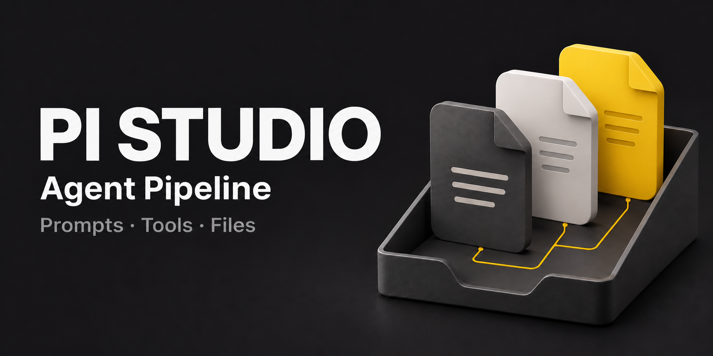

# Pi Studio

Простой десктопный харнес для **Pi** с поддержкой **skills, MCP и инструкций**. Настраивайте агентов и работайте с ними в локальных проектах. Диалоги идут в Pi, файлы остаются на вашем диске.

## Возможности

- **Команды агентов:** создание, порядок работы, импорт и экспорт.
- **Настройки каждого агента:** промпт, инструкции, skills, MCP-серверы и пакеты Pi.
- **Выбор модели:** отдельное подключение, модель и уровень рассуждения для каждого агента.
- **Проекты:** свои папки результатов и сохранённый диалог каждого агента.
- **Совместная работа:** параллельные агенты, последовательный запуск и поручения через MCP `team`.
- **Просмотр файлов:** текст, Markdown, JSON, изображения, аудио и видео; поиск и копирование текста.
- **Помощник настройки:** подключение ресурсов и создание агентов через диалог в Pi.

Новая студия начинается без готовых команд и примеров. Создайте своих агентов или импортируйте команду.

## Скачать

| Платформа | Сборка |
|---|---|
| macOS 13+ · Apple Silicon | [Скачать ZIP · alpha.75](https://github.com/vtlk/pi-studio/releases/download/v0.2.0-alpha.75/Pi-Studio-0.2.0-alpha.75-mac-arm64.zip) |
| Windows 10/11 · x64 | [Скачать ZIP · alpha.75 preview](https://github.com/vtlk/pi-studio/releases/download/v0.2.0-alpha.75/Pi-Studio-0.2.0-alpha.75-win-x64.zip) |

Это alpha: Mac-сборка подписана Apple Development, без notarization; Windows-сборка пока не проверена на Windows. Для загрузки нужен доступ к закрытому репозиторию.

На первом запуске Studio установит Pi, если подходящей версии нет в системе. Затем добавьте подключение к модели и создайте или импортируйте команду.

<details>
<summary>Интерфейс</summary>


Снимок отдельной тестовой студии. Показанные агенты и материалы не предустановлены.

</details>

## Разработка

```sh
npm ci
npm run dev
```

Electron, React, TypeScript. Проверки: `npm run typecheck`, `npm run lint`, `npm run check:architecture`, `npm test`. GitHub Actions выключены.

[Документация](technical-spec/README.md) · [Статус MVP](technical-spec/MVP_COMPLETION_AUDIT.md) · [Windows](technical-spec/WINDOWS.md) · [Обратная связь](https://github.com/vtlk/pi-studio/issues)
