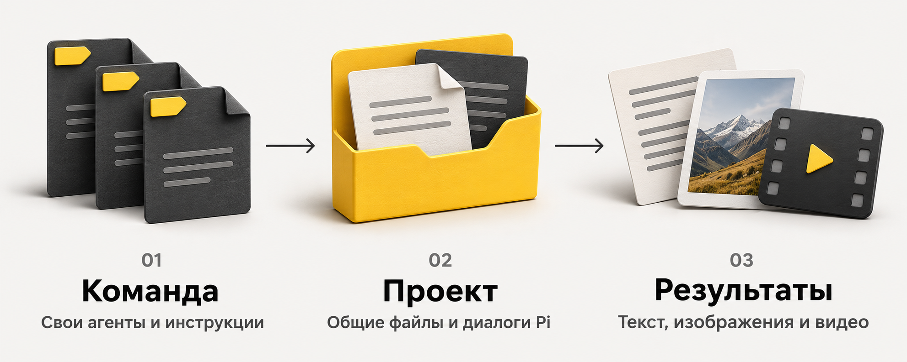
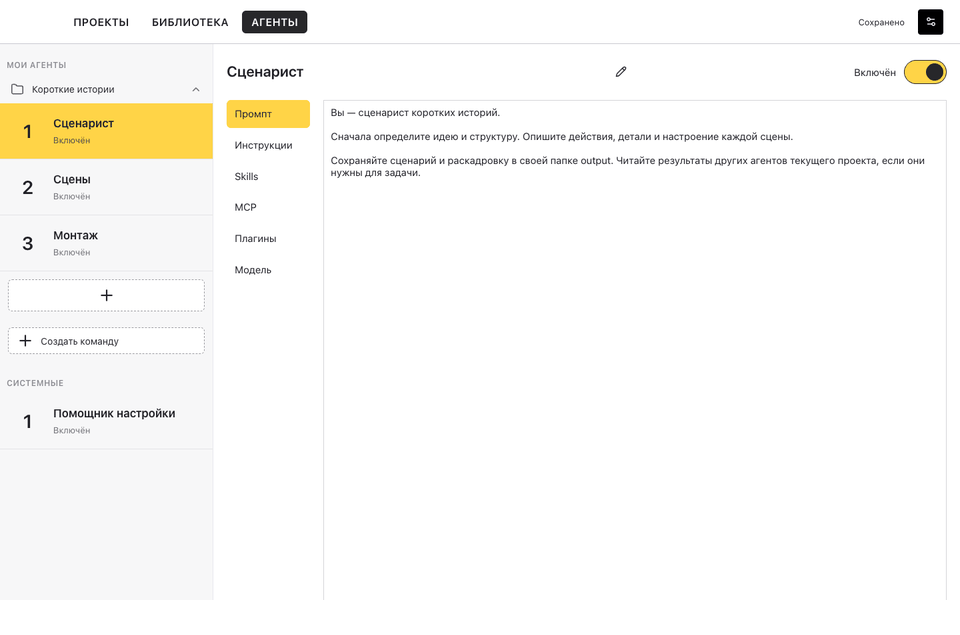
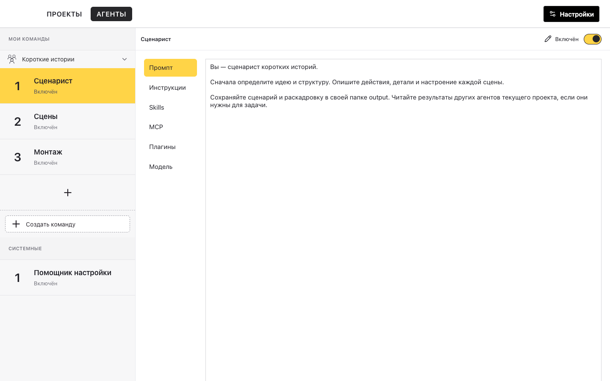
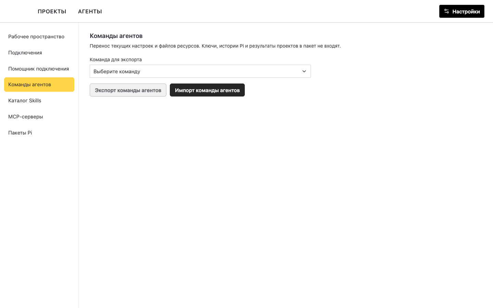

# Pi Studio

Соберите свою команду агентов Pi, дайте каждому инструкции и инструменты, работайте с результатами в одном проекте. Диалоги идут в Pi; файлы, сценарии, изображения и видео остаются на вашем диске.

**Новая установка начинается без команд, обычных агентов, проектов и демонстрационных материалов.** Встроен только помощник настройки. Команды и ресурсы создаёте или импортируете вы.

[Скачать macOS Apple Silicon · alpha.74](https://github.com/vtlk/pi-studio/releases/tag/v0.2.0-alpha.74) · [Статус Windows x64](technical-spec/WINDOWS.md) · [Документация](technical-spec/README.md) · [Обратная связь](https://github.com/vtlk/pi-studio/issues)

Сейчас репозиторий закрытый: для загрузки из Releases нужен доступ. Финальный стабильный выпуск ещё не принят. Опубликованная Mac alpha.74 подписана Apple Development; Developer ID/notarization пока не настроены. Windows x64 alpha.73 доступна в prerelease alpha.73 как portable preview ZIP; запуск на самой Windows ещё не проверен.

## Как устроена работа



1. **Команда.** Создайте своих агентов, задайте промпты и инструкции, выберите подключение, модель и уровень рассуждения. Подключите нужные Skills, MCP и пакеты Pi.
2. **Проект.** Укажите название и выберите команду. У каждого агента появятся собственные папки результатов и единственный диалог Pi.
3. **Задание.** Нажмите «Запустить» и напишите первый запрос. «Продолжить диалог» открывает тот же разговор; уточнения отправляете в Pi.
4. **Результат.** Читайте сценарии, смотрите изображения и видео, открывайте подготовленный агентом монтаж. Исправления поручайте агенту в том же диалоге.

Агенты могут работать параллельно. «Запустить и продолжить» позволяет передавать работу следующему агенту после подтверждённого завершения текущего. Обычный запуск относится к выбранному агенту.

<details>
<summary>Настоящий интерфейс: агенты, файлы и сценарий</summary>


*Скриншоты сняты с нативного интерфейса в отдельной студии для документации. Названия, команда и пример сценария созданы специально для снимков; они не входят в новую установку. Это демонстрация интерфейса, а не запись генерации.*

</details>

<details>
<summary>Короткий обзор: команда → проект → просмотр монтажа</summary>



Обзор интерфейса на материалах двух изолированных проверок. Кадр просмотра видео взят из QA-проекта озвучки от 15 ноября 2026; это не запись генерации и не обещание предустановленных агентов или материалов.

</details>

## Всё на своих местах

- **Команды агентов:** отдельные группы, порядок работы, включение и выключение, текущие промпты и инструкции. Изменённые инструкции применяются при следующем явном запуске или открытии диалога через Studio.
- **Ресурсы:** общий каталог Skills, MCP и пакетов Pi, явные назначения конкретным агентам. Помощник настройки работает в своём диалоге Pi.
- **MCP team (с alpha.73):** чтение настроек/результатов своей команды и поручения в точный диалог агента. `say_to_agent` ждёт завершения; очередь после перезапуска требует явного продолжения.
- **Проекты и файлы:** реальные папки, переименование и клонирование вместе с историей, восстановление удалённых проектов, дерево результатов и открытие в системном файловом менеджере.
- **Предпросмотр:** Markdown, текст и JSON с поиском, локальные изображения, аудио и видео. Копирование полного текста — прямо из панели файла.
- **Монтаж:** встроенный Remotion Player для проверенного `*.pistudio.json` с локальными материалами. Studio показывает результат; генерацию, сборку и MP4-экспорт выполняет агент своими инструментами.
- **Перенос команды:** Настройки → Команды агентов → импорт или экспорт `.pistudio-team`. Пакет переносит настройки и файлы ресурсов; ключи, диалоги и результаты проектов остаются за его пределами. Подключения на новом компьютере настраиваются явно.

<details>
<summary>Посмотреть настройку агентов и перенос команды</summary>





</details>

## Первый запуск

Распакуйте Mac ZIP, перенесите Pi Studio в Applications и откройте приложение. При отсутствии подходящего Pi стартовый экран предложит установить закреплённые Node 22.22.1 и Pi 1.5.2 в приватную папку приложения. Нужен интернет; существующий Pi можно выбрать отдельно.

В Настройках выберите папку студии и добавьте подключение к модели. Например, для Codex доступен штатный вход через ChatGPT. Затем создайте команду на странице «Агенты» и настройте модель каждого агента, включая помощника, если хотите им пользоваться. Studio не выбирает аккаунт или модель за вас.

Windows использует Windows Terminal и штатный для Pi Git Bash. Подробности предварительной сборки и её проверки — в [WINDOWS.md](technical-spec/WINDOWS.md).

## Где хранятся данные

Папка студии выбирается вами; на Mac по умолчанию это `~/Movies/Pi Studio`. Текущие настройки находятся в `.pistudio/studio.json`, проекты — в `projects/<folder-slug>/project.json`.

Результаты агента хранятся в `agents/<folder-slug>/output`, история Pi — в `sessions` рядом с output. Имена каталогов создаются как slug, внутренние ID остаются стабильными. Секреты приложения защищаются средствами ОС и хранятся отдельно от студии. Экспорт команды не переносит их.

## Состояние версии

| Область | Статус |
|---|---|
| macOS 13+ · Apple Silicon | Alpha.74 опубликована; оставшаяся ручная приёмка отражена в аудите |
| Windows 10/11 · x64 | Предварительная кросс-сборка alpha.73; нативная приёмка открыта |
| Claude Code · подписка | Провайдер встроен; проверка настоящего подписочного аккаунта и биллинга отложена |
| Browser / Computer Use | Встроенные MCP; для Computer Use нужны доступ ОС и подходящая модель. Реальная desktop-приёмка ещё не завершена |
| Автообновление | Добавлено в ТЗ, пока не реализовано |

[Поэлементный аудит MVP](technical-spec/MVP_COMPLETION_AUDIT.md) отделяет настоящие интеграционные проверки от UI/fixture-проверок и перечисляет оставшиеся задачи. Наличие alpha или Windows ZIP не означает завершение всего MVP.

## Для разработки

Node.js 22.19+; Electron, React, strict TypeScript и electron-vite.

```sh
npm ci
npm run dev
```

`npm run dev:web` запускает отдельный веб-макет с примерами без сохранения. Его материалы не попадают в native bundle.

```sh
npm run typecheck
npm run lint
npm run check:architecture
npm test
```

Mac-сборка: `PI_STUDIO_SIGN_IDENTITY='<существующий сертификат>' npm run package:mac`. Windows x64: `npm run package:win`. Упаковка сохраняет только текущие локальные ZIP; временная staging удаляется. GitHub Actions выключены, проверки выполняются локально.

Проверка секретов: [инструкция аудита](docs/REPOSITORY_AUDIT.md). [Шаблон release notes](.github/RELEASE_TEMPLATE.md). Условия сторонних компонентов и происхождение материалов — в `third-party-licenses`, соответствующих bundled-пакетах и [описании медиа](docs/media/README.md); публичная поставка проходит отдельную проверку прав и подписей.
