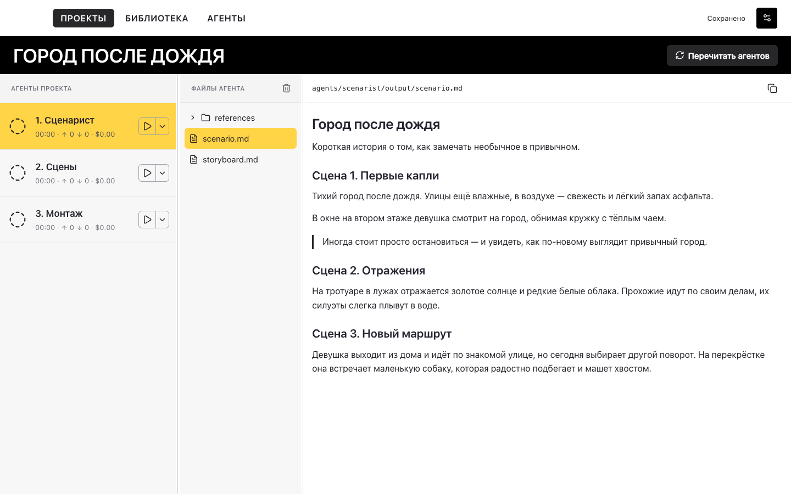

# Pi Studio

**Конвейер AI-агентов для поточной работы над проектами.** Pi Studio — бесплатное desktop-приложение с открытым исходным кодом на базе **Pi**. Соберите команду, задайте последовательность задач и используйте этот процесс снова в новых проектах.

Каждый агент отвечает за свой этап, использует свою модель и инструменты, получает результаты предыдущих участников. Так можно организовать повторяемую разработку, подготовку контента, исследование или производство видео. Диалоги идут в Pi, файлы проектов остаются на вашем диске.

[Скачать](#скачать) · [Подключения](#подключения-и-модели) · [Начать работу](#начать-работу) · [MIT License](LICENSE)

## Как работает конвейер

**Задача → агент исследования → агент разработки → агент проверки → результат.**

Названия и роли задаёте вы. Один раз настройте промпты, инструкции, skills, MCP и порядок команды, затем создавайте отдельные проекты для однотипных задач. Запускайте этапы вручную или выберите «Запустить и продолжить» для последовательного выполнения. Если агент задаёт вопрос или возникает ошибка, конвейер останавливается для уточнения.

У каждого агента — собственный сохранённый диалог и папка результатов. К любому этапу можно вернуться и продолжить работу в том же диалоге.

## Возможности

- **Повторяемые процессы:** команды агентов с заданным порядком работы, импортом и экспортом настроек для новых проектов.
- **Настройки каждого агента:** промпт, инструкции, skills, MCP-серверы и пакеты Pi.
- **Выбор модели:** отдельное подключение, модель и уровень рассуждения для каждого агента.
- **Проекты:** свои папки результатов и сохранённый диалог каждого агента.
- **Агенты обращаются друг к другу:** через MCP `team` агент может передать задачу другому участнику команды, дождаться завершения его работы и прочитать ответ и файлы результатов в текущем проекте.
- **MCP:** подключение внешних MCP-серверов и назначение их инструментов конкретным агентам; локальный stdio, HTTP и авторизация по возможностям сервера и Pi.
- **Browser Use:** работа с сайтами в отдельном браузере — вкладки, снимки страниц, клики, ввод текста, загрузка и скачивание файлов проекта.
- **Computer Use:** инструменты управления приложениями через снимки окон, клики, клавиатуру и прокрутку. На macOS нужны системные разрешения Accessibility и Screen Recording.
- **Просмотр файлов:** текст, Markdown, JSON, изображения, аудио и видео; поиск и копирование текста.
- **Помощник настройки:** подключение ресурсов и создание агентов через диалог в Pi.

Новая студия начинается без готовых команд и примеров. Создайте своих агентов или импортируйте команду.

Для визуальной работы с браузером и компьютером нужна модель с поддержкой изображений; компоненты браузера устанавливаются отдельно. Computer Use находится на alpha-стадии: полная проверка управления реальными приложениями с выданными разрешениями ещё не завершена. Нативная работа этих инструментов на Windows требует отдельной проверки.

## Подключения и модели

Для каждого агента отдельно выбираются подключение, модель и уровень рассуждения. Studio использует каталог **Pi 1.5.2**, встроенный провайдер Claude Code и установленные native-расширения Pi.

| Подключение | Способ работы |
|---|---|
| **OpenAI Codex** | Вход через ChatGPT; доступ определяется аккаунтом и тарифом |
| **Claude Code** | Через официальный CLI и его подписочный вход; расширение включено в Studio, CLI устанавливается отдельно |
| **OpenAI, Anthropic, Google, xAI, DeepSeek, Mistral** | Прямые подключения через поддерживаемые Pi методы авторизации |
| **GitHub Copilot** | Вход через GitHub по возможностям Pi и вашего аккаунта |
| **OpenRouter, Groq, Cerebras, Together, Fireworks и другие** | Агрегаторы и сервисы доступа к моделям из каталога Pi |
| **Amazon Bedrock, Azure, Google Vertex AI** | Облачные подключения с настройками соответствующего провайдера |
| **Совместимые API и локальные серверы моделей** | Явный адрес, список моделей и протокол OpenAI Completions или Responses |

<details>
<summary>Все 43 встроенных провайдера Pi 1.5.2</summary>

Amazon Bedrock, Ant Ling, Anthropic, Azure, Baseten, Cerebras, Cloudflare AI Gateway, Cloudflare Workers AI, DeepSeek, Fireworks, GitHub Copilot, Google, Google Vertex AI, Groq, Hugging Face, Kimi For Coding, Meta, MiniMax, MiniMax CN, Mistral, Moonshot AI, Moonshot AI CN, NVIDIA, OpenAI, OpenAI Codex, OpenCode Zen, OpenCode Go, OpenRouter, Qwen Token Plan, Qwen Token Plan CN, Qwen Token Plan Individual, Qwen Token Plan Individual CN, Radius, Together, TypeSafe, Vercel AI Gateway, xAI, Xiaomi, Xiaomi Token Plan AMS, Xiaomi Token Plan CN, Xiaomi Token Plan SGP, Z.AI, Z.AI Coding CN.

Claude Code подключён дополнительно как встроенное расширение Studio. Native-расширения Pi могут добавлять другие провайдеры.

</details>

Конкретные модели и способы входа зависят от провайдера, версии Pi и прав аккаунта. Наличие в каталоге не означает проверку всех внешних сервисов. Реальное списание подписочной квоты Claude Code ещё требует отдельной проверки. Автоматической подмены аккаунта, модели или перехода на платный API нет.

## Скачать

| Платформа | Сборка |
|---|---|
| macOS 13+ · Apple Silicon | [Скачать ZIP · alpha.77](https://github.com/vtlk/pi-studio/releases/download/v0.2.0-alpha.77/Pi-Studio-0.2.0-alpha.77-mac-arm64.zip) |
| Windows 10/11 · x64 | [Скачать ZIP · alpha.77 preview](https://github.com/vtlk/pi-studio/releases/download/v0.2.0-alpha.77/Pi-Studio-0.2.0-alpha.77-win-x64.zip) |

Это alpha: Mac-сборка подписана Apple Development, без notarization; Windows-сборка пока не проверена на Windows. Для загрузки нужен доступ к закрытому репозиторию.

## Начать работу

1. Установите Studio. На первом запуске она предложит установить Pi, если подходящей версии нет в системе.
2. Добавьте подключение к модели и выполните вход.
3. Создайте или импортируйте команду; назначьте агентам модели, инструкции и нужные инструменты.
4. Создайте проект, выберите команду и запустите первый этап. Для последовательного выполнения выберите «Запустить и продолжить».

<details>
<summary>Интерфейс</summary>



Снимок отдельной тестовой студии. Показанные агенты и материалы не предустановлены.

</details>

## Open source

Исходный код Pi Studio распространяется по [лицензии MIT](LICENSE): можно бесплатно пользоваться программой, изменять код и распространять свои версии, в том числе для коммерческих задач, с сохранением уведомления об авторстве и текста лицензии.

Лицензии сторонних компонентов сохраняются отдельно в [third-party-licenses](third-party-licenses). У Remotion есть собственные [условия лицензирования](https://www.remotion.dev/license); MIT Pi Studio не заменяет их. Подписки моделей, API и внешние сервисы оплачиваются по правилам их поставщиков.

Репозиторий пока закрыт на время подготовки публичного выпуска; доступ к исходникам и загрузкам сейчас есть у его участников. Публичное открытие — отдельный этап после финального аудита и приёмки релизов.

## Разработка

```sh
npm ci
npm run dev
```

Electron, React, TypeScript. Проверки: `npm run typecheck`, `npm run lint`, `npm run check:architecture`, `npm test`. GitHub Actions выключены.

[Документация](technical-spec/README.md) · [Статус MVP](technical-spec/MVP_COMPLETION_AUDIT.md) · [Windows](technical-spec/WINDOWS.md) · [Обратная связь](https://github.com/vtlk/pi-studio/issues)
