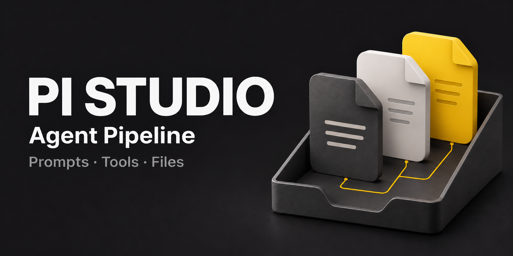
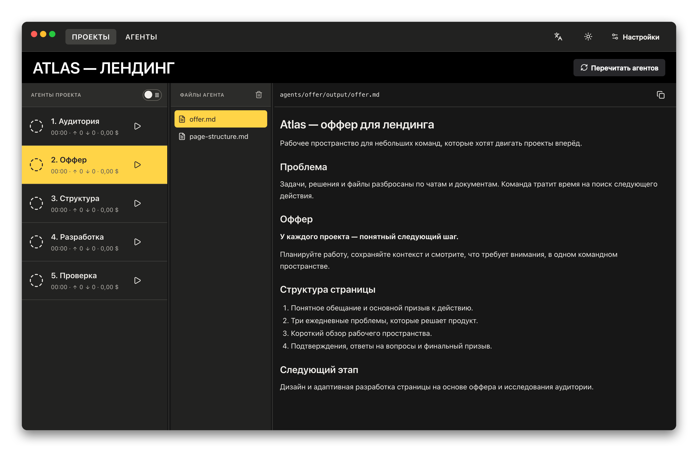
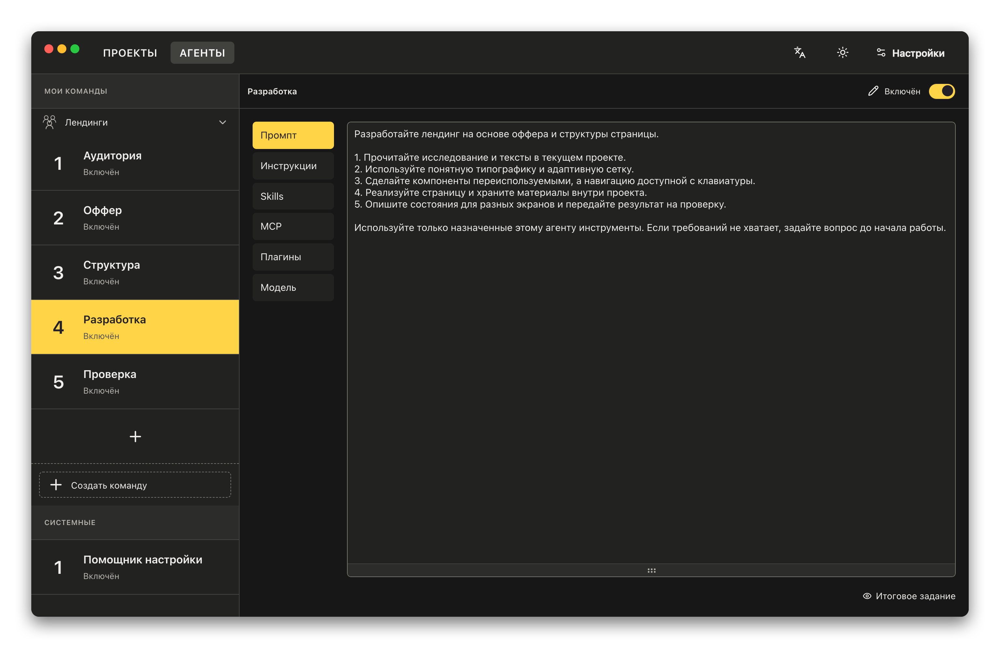
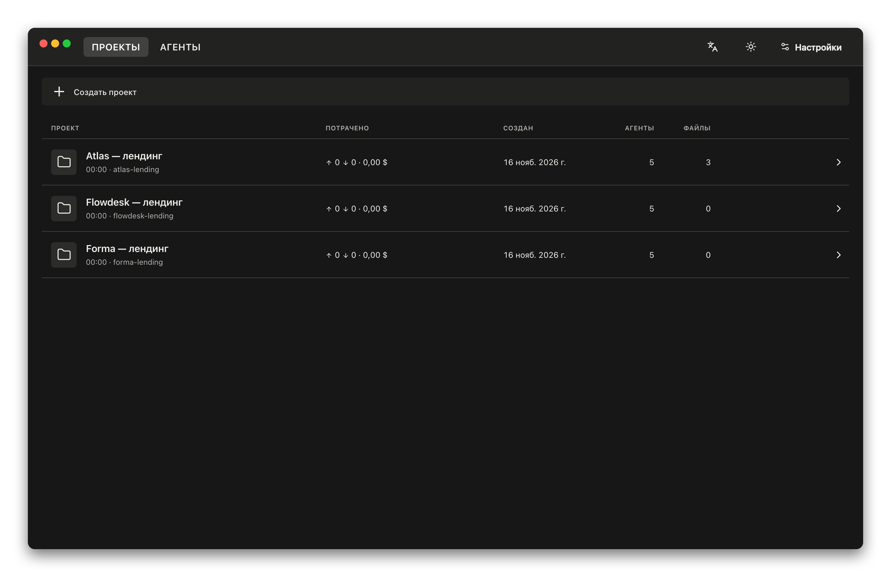

<p align="center"><a href="README.md">English</a> · <strong>Русский</strong></p>

<div align="center">



### Конвейер для производства типовых продуктов с помощью AI-агентов

Один агент исследует, другой делает, третий проверяет.<br>Настройте порядок работы один раз — используйте его в новых проектах.

<a href="LICENSE"></a>  

**[Скачать для macOS ↓](https://github.com/vtlk/pi-studio/releases/download/v0.2.0-alpha.85/Pi-Studio-0.2.0-alpha.85-mac-arm64.zip)** &nbsp; · &nbsp; **[Windows preview ↓](https://github.com/vtlk/pi-studio/releases/download/v0.2.0-alpha.78/Pi-Studio-0.2.0-alpha.78-win-x64.zip)**

**[Как это работает](#одна-команда-много-проектов)** &nbsp; · &nbsp; **[Модели](#ваши-модели-ваши-инструменты)** &nbsp; · &nbsp; **[Начать](#быстрый-старт)**

</div>

## Одна команда, много проектов

**Pi Studio объединяет AI-агентов в конвейер:** каждый выполняет свой этап и передаёт результат дальше. Соберите команду для разработки, контента или видео и используйте её в каждом новом проекте.

В основе — [Pi](https://github.com/earendil-works/pi). У каждого агента своя модель, инструкции, инструменты, диалог и папка с результатами. Файлы хранятся на вашем компьютере.



<sub>Актуальный интерфейс macOS на русском языке в тёмной теме. Проект лендинга использует примеры данных, созданные для документации.</sub>

## Что можно поставить на поток

Продукты создаются по вашим инструкциям и правилам, с использованием ваших внешних подключений и инструментов, а также браузера и управления приложениями компьютера через Computer Use.

Одна команда может повторять весь производственный процесс для новых продуктов, клиентов или выпусков. Например, так могут выглядеть ваши цепочки:

| Направление | Пример цепочки |
|:---|:---|
| **Лендинги** | Анализ болей аудитории → создание оффера → определение типа лендинга → дизайн и разработка → проверка адаптивности |
| **CRM-системы** | Описание бизнес-процессов → анализ интеграций → составление ТЗ → разработка → ревью и тестирование → деплой |
| **Видео** | Идея и сценарий → раскадровка и подготовка материалов → анимация, озвучка и монтаж → проверка и финальный ролик → публикация |
| **Контент** | Исследование темы и аудитории → контент-план и структура → генерация материалов → редактура → автопостинг |
| **Реклама** | Анализ продукта → создание офферов → производство креативов и вариантов → адаптация под площадки → автопостинг |

Роли, инструменты и число этапов задаёте вы. Цепочку можно сделать длиннее, разделив сложные этапы между несколькими агентами.

## Как работает команда

| 1. Настройте | 2. Запустите | 3. Повторите |
|:---|:---|:---|
| Добавьте агентов, объясните каждому его задачу и подключите нужные инструменты. | Создайте проект и выберите «Запустить и продолжить». Агенты выполнят этапы по порядку. | Используйте ту же команду для следующего проекта. У каждого проекта останутся свои файлы и диалоги. |

Можно запускать этапы вручную, возвращаться к любому агенту и просить изменения в его диалоге. Вопрос или ошибка останавливают автоматическое продолжение.

### Агенты могут обращаться друг к другу

Агент может поручить задачу другому участнику команды через MCP **Pi Studio Team**, дождаться завершения его работы и прочитать результат.

> Например, автор просит исследователя уточнить факты, а затем использует его материалы в тексте.

Инструмент работает с участниками команды в текущем проекте и назначается явно.

## Ваши модели, ваши инструменты

Для каждого агента выбирайте своё подключение и модель. Например, один агент может работать через Codex, а другой — через Claude Code.

| Подключения | Что доступно |
|:---|:---|
| **ChatGPT / Codex, Claude Code, GitHub Copilot** | Подключение своего аккаунта через поддерживаемый вход |
| **OpenAI, Anthropic, Google, xAI, DeepSeek, Mistral** | Прямые подключения к поставщикам моделей |
| **OpenRouter, Groq, Cerebras, Together, Fireworks и другие** | Модели через агрегаторы и сервисы |
| **Amazon Bedrock, Azure, Google Vertex AI** | Облачные подключения |
| **Локальные модели и совместимые API** | Свой сервер с явно заданным адресом и моделями |

**[Все подключения и способы входа →](docs/CONNECTIONS.md)**

### Подключайте агентам нужные возможности

<table>
<tr>
<td width="50%" valign="top">

**MCP — доступ к сервисам**

Подключайте внешние MCP-серверы и назначайте их инструменты нужным агентам.

</td>
<td width="50%" valign="top">

**Skills — навыки для работы**

Добавляйте инструкции и навыки, чтобы агент выполнял задачу по вашим правилам.

</td>
</tr>
<tr>
<td width="50%" valign="top">

**Browser Use — работа с сайтами**

Агент видит страницу, нажимает кнопки, вводит текст и работает с файлами в отдельном браузере.

</td>
<td width="50%" valign="top">

**Computer Use — работа с приложениями**

Инструменты снимков окон, кликов, клавиатуры и прокрутки. Требуют разрешений ОС; полная проверка ещё продолжается.

</td>
</tr>
</table>

Для браузера и Computer Use нужна модель, которая понимает изображения. Компоненты браузера устанавливаются отдельно. [Условия и текущие ограничения →](docs/CONNECTIONS.md#браузер-и-computer-use)

## Помощник настройки

В Studio есть **отдельный встроенный агент**, которому можно поручить настройку инструментов и навыков. Объясните обычными словами, что нужно подключить и какому агенту:

> «Подключи этот MCP-сервер к агенту „Исследователь“».
>
> «Установи этот скилл и добавь его агенту „Разработчик“».
>
> «Найди подходящий навык для монтажа видео и подключи его агенту „Монтажёр“».

Помощник может искать навыки, устанавливать совместимые пакеты, настраивать MCP-серверы и назначать ресурсы конкретным агентам. Если сервис требует входа или API-ключа, авторизация проходит через браузер или защищённые поля приложения.

Выберите для помощника подключение и модель, затем откройте его диалог в **«Агенты → Системные → Помощник настройки»**.

## Скачать

| | macOS | Windows |
|:---|:---|:---|
| **Сборка** | **[Скачать для Mac ↓](https://github.com/vtlk/pi-studio/releases/download/v0.2.0-alpha.85/Pi-Studio-0.2.0-alpha.85-mac-arm64.zip)** | **[Скачать для Windows ↓](https://github.com/vtlk/pi-studio/releases/download/v0.2.0-alpha.78/Pi-Studio-0.2.0-alpha.78-win-x64.zip)** |
| **Требования** | macOS 13+, Apple Silicon | Windows 10/11, x64 |
| **Версия** | alpha.85 | alpha.78 · preview |

> **Ранняя версия.** Mac-сборка подписана Apple Development, без нотарификации Apple. Windows-сборка ещё не проверена на настоящем Windows-компьютере.

[Что изменилось в alpha.85 →](https://github.com/vtlk/pi-studio/releases/tag/v0.2.0-alpha.85)

## Быстрый старт

1. **Установите Studio.** Если нужной версии Pi нет, приложение предложит её установить.
2. **Подключите модель.** Добавьте своё подключение и выполните вход.
3. **Соберите команду.** Создайте агентов, задайте роли и порядок — или импортируйте настройки команды. Подключение инструментов можно поручить [помощнику настройки](#помощник-настройки).
4. **Создайте проект.** Выберите команду и запустите первый этап.

Новая студия пустая: без чужих проектов, готовых команд и подключённых аккаунтов.

<details>
<summary><strong>Ещё скриншоты</strong></summary>

### Настройка агентов



### Управление проектами



Настоящие снимки приложения с примерами лендингов, оформленные оконными кнопками macOS и тенью на прозрачном фоне. Примеры не предустановлены и не являются результатом запуска модели.

</details>

## Бесплатно и с открытым кодом

Pi Studio распространяется по **[MIT](LICENSE)**. Программой можно пользоваться бесплатно, изменять её и распространять свои версии, в том числе для коммерческих задач.

Подписки моделей, API и внешние сервисы оплачиваются отдельно по тарифам их поставщиков. У сторонних компонентов свои лицензии: [уведомления](third-party-licenses).

Исходный код и сборки доступны на GitHub.

<details>
<summary><strong>Для разработчиков</strong></summary>

Electron · React · TypeScript.

```sh
npm ci
npm run dev
```

Проверки: `npm run typecheck`, `npm run lint`, `npm run check:architecture`, `npm test`.

При изменении возможностей и каждом релизе синхронизируйте английский и русский README, включая все ссылки загрузок, версии платформ и ссылку на изменения.


</details>

---

<div align="center">

**[Скачать](#скачать)** &nbsp; · &nbsp; **[Сообщить об ошибке](https://github.com/vtlk/pi-studio/issues)**

</div>
